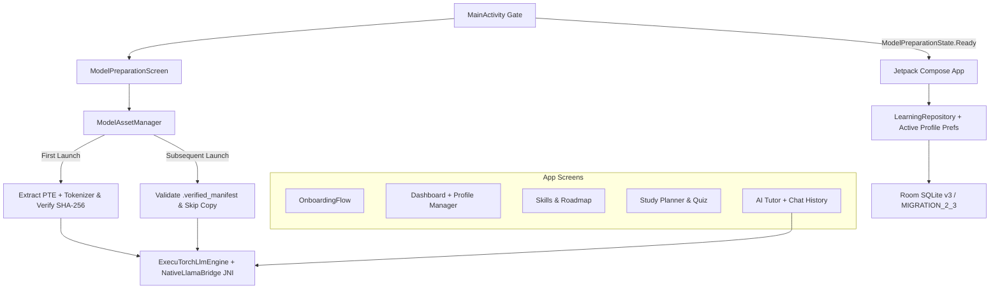

# LearnMate AI: Offline On-Device Personalized AI Learning Companion for Android

**Competition:** Bharat AI-SoC Student Challenge  
**Verified Physical Hardware:** Xiaomi Redmi 9 Power (Qualcomm Snapdragon 662, 4 GB RAM, Android 12)  
**Application Package & Version:** `com.learnmate.ai` (`versionName` `1.0.0`, `versionCode` `1`, `minSdk` 26, `targetSdk` 35, `arm64-v8a`)  
**Author / Team:** LearnMateAI — Sahil Nagvekar, Sanjana Choudhary  
**Repository:** https://github.com/Sahil1719/LearnMate-AI  
**Release Date:** November 25, 2026 (IST)  

> **Submission & Compliance Disclosure:** The signed Release APK and automated/device verifications summarized below are frozen as of November 25, 2026. External competition form submission has not occurred yet, and no demo video has been recorded yet. Regarding model compliance: the Bharat AI-SoC brief reviewed for this project specifies a **Llama-family model deployed on-device using ExecuTorch** on an ARM-based Android smartphone, whereas mentor guidance to our team specifically identified **Meta Llama 3 8B Instruct**. The final submitted APK contains **Meta Llama 3.2 3B Instruct INT4** (`learnmate_llama3_2_3b.pte`), **not** Meta Llama 3 8B Instruct; strict 8B compliance was not achieved and is explicitly flagged below.

---

## Abstract

Access to structured, personalized tutoring is frequently constrained by intermittent internet connectivity, recurring cloud costs, and privacy concerns over sharing academic performance externally. **LearnMate AI** is a self-contained, offline-first personalized learning companion Android application built in Jetpack Compose and powered natively on-device by **Meta Llama 3.2 3B Instruct** (merged INT4 `8da4w` `.pte` via **ExecuTorch v0.5.0** with XNNPACK NEON).

Unlike cloud-dependent tools or sideloaded prototypes, the final Release APK (`app-release.apk`, `1,956,712,238` bytes) packages `learnmate_llama3_2_3b.pte` (`1,929,907,360` bytes) and `tokenizer.model` (`2,183,982` bytes) directly inside the signed APK, stored uncompressed using `noCompress`. On first launch, `ModelAssetManager` checks free storage (`2,036,948,942` bytes threshold), extracts both assets once into app-private storage, verifies exact SHA-256 digests, and initializes the native `mmap` runner. Subsequent cold relaunches validate `.verified_manifest` and skip re-copying. Persistence uses **Room SQLite v3** (`MIGRATION_2_3`) supporting multi-profile learner data scoping and durable per-profile AI Tutor conversation histories. The release codebase passes **81/81** Android Release unit tests (`0` failures, `0` errors, `0` skipped across 18 suites, with passing Debug and Release unit test builds) and completed clean-install offline verification on a physical Xiaomi Redmi 9 Power (`0.49–0.86 tok/s` native generation across 3 live offline queries).

---

## 1. Final Release Build, Model Alignment & Artifact Inventory

### 1.1 Competition Model Alignment vs. Mentor Guidance
- **Competition Brief Scope:** The reviewed Bharat AI-SoC Student Challenge brief specifies deploying a **Meta Llama-family model on-device using ExecuTorch** on an ARM-based Android smartphone.
- **Mentor-Specified Baseline vs. Shipped Artifact (Mismatch Flagged):** Mentor guidance to our team specifically identified **Meta Llama 3 8B Instruct**. However, the estimated INT4 8B artifact size (`~4.27 GB` / `~4.9 GB` depending on quantization/export packaging) plus runtime memory requirements exceed the practical available memory budget of the target `4 GB` Redmi 9 Power device, and the 8B model was **not** successfully deployed or evaluated on the Redmi 9 Power. Consequently, the shipped APK deploys **Meta Llama 3.2 3B Instruct INT4** (`learnmate_llama3_2_3b.pte`, `1,929,907,360` bytes) instead of Llama 3 8B Instruct. We explicitly disclose that the final APK does not use Meta Llama 3 8B and does not satisfy a strict 8B parameter-count requirement.

### 1.2 Verified Artifact Checksums & Build Configuration
Authoritative checksums are recorded in [final_submission_checksums.txt](../reports/final_submission_checksums.txt) and [FINAL_RELEASE_BUILD_AND_TEST_REPORT.md](../reports/FINAL_RELEASE_BUILD_AND_TEST_REPORT.md):

| Artifact | Size (Bytes) | Artifact Path & Verified SHA-256 |
|---|---:|---|
| **Signed Release APK** | `1,956,712,238` | `android-app/app/build/outputs/apk/release/app-release.apk`<br/>`SHA-256: 664409BA8E2F7B2EC4EBC0EA165691C493FD7D95EB439558E8B1DFF8C6AC2828` |
| **Merged INT4 PTE Model** | `1,929,907,360` | `model/android/learnmate_llama3_2_3b.pte`<br/>`SHA-256: 8C545BDE51BD434BFB922402AAA33C8952871735C04DE22A9DD84F587F936B91` |
| **TikToken Tokenizer** | `2,183,982` | `model/android/tokenizer.model`<br/>`SHA-256: 82E9D31979E92AB929CD544440F129D9ECD797B69E327F80F17E1C50D5551B55` |
| **Model Export Manifest** | — | `model/android/learnmate_model_manifest.json`<br/>`params.json SHA-256: 8DC6F4E12B42CB7C72DE95AE0721FE302694592C5FB8D3FC2E8530FF4118FFDD` |

- **Package & SDK Targets:** `com.learnmate.ai`, `versionCode = 1`, `versionName = "1.0.0"`, `minSdk = 26`, `compileSdk = 35`, `targetSdk = 35`, ABI `arm64-v8a`.
- **Signing & Source Hygiene:** Signed with a local release keystore (`apksigner` v2 verified); `*.jks`, `keystore.properties`, `android-app/app/src/main/assets/models/`, and `.pte` model weights are excluded from Git via `.gitignore`.
- **Uncompressed Asset Packaging:** `lib/arm64-v8a/libexecutorch_llama_jni.so` (`13,255,408` bytes), `assets/models/learnmate_llama3_2_3b.pte`, and `assets/models/tokenizer.model` are stored uncompressed using `noCompress` (`compress_type=0`) for direct streaming extraction.

---

## 2. System Architecture & Runtime Behavior



### 2.1 Self-Contained First-Launch Extraction & Cold-Launch Reuse
1. **Free-Space Precheck:** Before copying, `ModelAssetManager.kt` checks `StatFs` against a threshold of `2,036,948,942` bytes (`~2.04 GB` / `~1.90 GiB`, comprising the `1,932,091,342` bytes of extracted model + tokenizer assets plus `104,857,600` bytes / `100 MiB` of safety headroom).
2. **One-Time Streaming Extraction & Integrity Check:** `ModelPreparationScreen.kt` displays copy progress while `ModelAssetManager` extracts `models/tokenizer.model` and `models/learnmate_llama3_2_3b.pte` into `context.filesDir/models/`, verifying exact byte lengths and streaming SHA-256 digests.
3. **Manifest Caching:** Upon checksum verification, `.verified_manifest` is written alongside the extracted files. On subsequent launches, `ModelAssetManager` detects `.verified_manifest` and skips re-extracting the `1.93 GB` `.pte`.
4. **Clean Fresh-Install Posture:** `AndroidManifest.xml` sets `android:allowBackup="false"` so fresh installs start cleanly on onboarding with no pre-seeded or cloud-restored profiles.

### 2.2 Authentic Local On-Device Inference (`ExecuTorchLlmEngine.kt`)
- **Runtime Configuration:** `LearnMate_NativeLlama` initializes `learnmate_llama3_2_3b.pte` and `tokenizer.model` (`vocab_size=128256`) from `context.filesDir/models/` with `mmap=1`, `seq_len=128`, and `threads=4` via `libexecutorch_llama_jni.so` (ExecuTorch v0.5.0 XNNPACK NEON).
- **No Silent Synthetic Fallback:** When `NativeLlamaBridge.isAvailable()` is `true` and native initialization fails (`nativeHandle == 0L`), `ExecuTorchLlmEngine.generateStream()` refuses to fall back to `synthesizeDeterministicResponse()`. Instead, it emits `InferenceState.Error` and throws explicitly, and `AiTutorScreen.kt` renders a native error banner.

### 2.3 Multi-Profile Scoping & Persistent AI Tutor History (Room v3)
- **Database Migration:** `LearnMateDatabase.kt` was upgraded to **version 3** with explicit non-destructive `MIGRATION_2_3` (matching KSP-generated schema) and `.fallbackToDestructiveMigration()` removed.
- **Per-Profile Isolation & Management UI:** `profileId` scoping and composite primary keys isolate `SkillEntity`, `RoadmapPhaseEntity`, `StudyTaskEntity`, and `AssessmentRecordEntity` per profile via `LearningRepository` (`SharedPreferences` active profile ID + `flatMapLatest` flows), paired with a Profile Manager dialog in `DashboardScreen.kt` (Create, Switch, Edit via `OnboardingFlow.kt`, Delete).
- **Durable Chat History:** `ConversationEntity`, `ChatMessageEntity` (cascade-delete FK + index), and `ConversationDao` persist per-profile AI Tutor conversations across restarts; `AiTutorScreen.kt` provides a history dialog with timestamps, New Chat, Reopen, and Delete actions.

---

## 3. Verification Summary: What Was Tested vs. Not Tested

### 3.1 Automated Unit Tests (Verified After Final Code Edits)
Executed with Android Studio JBR (`JAVA_HOME=C:\Program Files\Android\Android Studio\jbr`):

```powershell
.\gradlew.bat testDebugUnitTest testReleaseUnitTest --rerun-tasks --console=plain
```

- **Build Result:** `BUILD SUCCESSFUL in 1m 55s` (`51 actionable tasks: 51 executed`) — both Debug and Release unit test builds succeeded.
- **Release Test Suite Breakdown (`app/build/test-results/testReleaseUnitTest/*.xml`):** **81 tests run, 0 failures, 0 errors, 0 skipped** across 18 suites: `LlmInferenceEngineTest` (`24/24`), `ContextAwareOnboardingScenariosTest` (`13/13`), `ScenarioA`–`ScenarioH` (`10/10` across 8 suites), `DatabaseEntitiesPersistenceTest` (`7/7`), `InferenceProfileManagerTest` (`7/7`), `AllCareerPathwaysSkillGapTest` (`5/5`), `ModelSelectionManagerTest` (`5/5`), `OfflineQuizBankTest` (`5/5`), `AdaptiveRemediationWorkflowTest` (`3/3`), `AdaptiveRemediationTest` (`1/1`), `SkillGapEngineTest` (`1/1`).

### 3.2 Physical Clean-Install Device Verification (Xiaomi Redmi 9 Power)
Tested directly on a physical **Xiaomi Redmi 9 Power** (Snapdragon 662, 4 GB RAM, Android 12) after `adb uninstall com.learnmate.ai`, clearing `/storage/emulated/0/Android/data/com.learnmate.ai`, and installing `app-release.apk` through the on-device Android package installer:

1. **First Launch & Asset Extraction (Verified):**
   - `ModelAssetManager`: Verified extracted `.pte` and `tokenizer.model` SHA-256 digests in `/data/user/0/com.learnmate.ai/files/models`.
   - `LearnMate_NativeLlama`: Loaded TikToken (`vocab_size=128256`) and ExecuTorch runner via `mmap=1` (`handle=1001`) in `34,222 ms`.
   - `uiautomator dump` confirmed clean landing on `"Personalized On-Device AI Learning"` / `"Get Started"` with zero pre-existing profiles.
2. **Offline AI Tutor Inference & Profile Persistence (Verified):**
   - Network radios disabled via ADB (`settings get global wifi_on -> 0`, `mobile_data -> 0`) during offline testing, and Wi-Fi re-enabled (`svc wifi enable`) afterward.
   - Executed **3 real on-device Llama 3.2 3B inferences** via the AI Tutor with `<|eot_id|>` stop handling, zero fallbacks, and zero crashes:
     - Query 1: `promptTokens=42`, `tokensEmitted=28`, `ttftMs=6630`, `totalMs=32685`, `tokPerSec=0.8566621`
     - Query 2: `promptTokens=49`, `tokensEmitted=8`, `ttftMs=8447`, `totalMs=16195`, `tokPerSec=0.49397963`
     - Query 3: `promptTokens=61`, `tokensEmitted=14`, `ttftMs=8305`, `totalMs=21241`, `tokPerSec=0.6591027`
   - Confirmed active persisted test profile `"Tanushree"` (`Clinical Physician / Doctor Readiness`, `Medicine & Surgery (MBBS / Clinical Practice)`) on Dashboard.
3. **Cold Relaunch Persistence & Model Reuse (Verified):**
   - Force-stopped via `adb shell am force-stop com.learnmate.ai` while offline and relaunched `.MainActivity`:
   - `ModelAssetManager` logged `Persisted model & tokenizer already verified on disk (/data/user/0/com.learnmate.ai/files/models)` and skipped re-extracting the `1.93 GB` model.
   - Native runner reloaded via `mmap=1` (`handle=1001`) in `31,379 ms`; `uiautomator dump` confirmed `"Hello, Tanushree"` profile state restored intact.

### 3.3 Features Not Physically Verified or Stopped Prior to Release
- **Phase 3.7 Precision-Isolation Evaluation (Stopped / Not Completed):** Phase 3.7 was stopped during read-only checkpoint discovery because the merged Hugging Face checkpoint was unavailable. Precision-isolation evaluation was **not** completed, and no higher-precision vs. INT4 quality conclusions are claimed.
- **Unverified Interactive Flows on Device:** Multi-profile switching/isolation across multiple profiles, deleting individual conversations, and interactive quiz/remediation flows are implemented and covered by source inspection and unit tests (`81/81`), but were **not** separately captured via isolated end-to-end physical UI walkthrough logs on the Redmi 9 Power.
- **Device Scope:** Only the Xiaomi Redmi 9 Power was physically tested; compatibility or performance across every Android device is **not** claimed.

---

## 4. Known Limitations & Technical Disclosures

1. **Inference & Model Load Latency on 4 GB RAM Hardware:** Executing a 3B INT4 model via CPU XNNPACK `mmap` on Snapdragon 662 yields **0.49–0.86 tokens/s** (`6.63–8.45 s` TTFT, `16.2–32.7 s` total generation for `8–28` emitted tokens) and **~31.4–34.2 s** cold `mmap` initialization time.
2. **Context Window Limit:** Native inference uses `seq_len=128` to fit 4 GB RAM limits (`avail=310–494 MB` observed under foreground memory pressure level 15 during execution).
3. **Storage Breakdown (Actual Combined Footprint vs. Threshold):** The signed APK occupies `1,956,712,238` bytes (`~1.82 GiB` / `1.96 GB`) and extracted model + tokenizer assets occupy `1,932,091,342` bytes (`~1.80 GiB` / `1.93 GB`), resulting in an **actual combined footprint of `3,888,803,580` bytes (`~3.62 GiB` / `3.89 GB`)** on internal storage once extracted. Separately, `ModelAssetManager.kt` enforces a `2,036,948,942`-byte (`~1.90 GiB` / `~2.04 GB`) **free-space precheck threshold** prior to first-launch extraction (`1,932,091,342` bytes for extracted assets + `104,857,600` bytes / `100 MiB` safety headroom).
4. **Physical Test & Submission Status Constraints:** On MIUI, USB debugging restricted simulated `adb shell input tap` (`INJECT_EVENTS`), so interactive device flows were operated manually and verified via `logcat` and `uiautomator dump`. No demo video has been recorded yet, and competition form submission has not occurred yet.

---

## 5. Model Attribution, License & Technical References

- **Model Attribution & License:** Built with **Meta Llama 3.2**. The bundled model weights (`meta-llama/Llama-3.2-3B-Instruct`, fine-tuned/exported to INT4 `.pte`) are subject to the **Meta Llama 3.2 Community License Agreement** and Meta's Acceptable Use Policy. The mentor-referenced baseline (`meta-llama/Meta-Llama-3-8B-Instruct`) is governed by the Meta Llama 3 Community License.
- **Technical References:**
  - PyTorch ExecuTorch (`v0.5.0`, commit `484a4ab5b717ce1f364c469509214d0ed0cdaf11`), XNNPACK ARM NEON delegate, and TorchAO `8da4w` (`Int8DynActInt4WeightQuantizer`)
  - Android Jetpack Compose, Material 3, Room SQLite (`v3` / `MIGRATION_2_3`), and Android NDK (`r26c` native toolchain)
  - Project Verification Baseline: `reports/FINAL_RELEASE_BUILD_AND_TEST_REPORT.md` and `reports/final_submission_checksums.txt`
